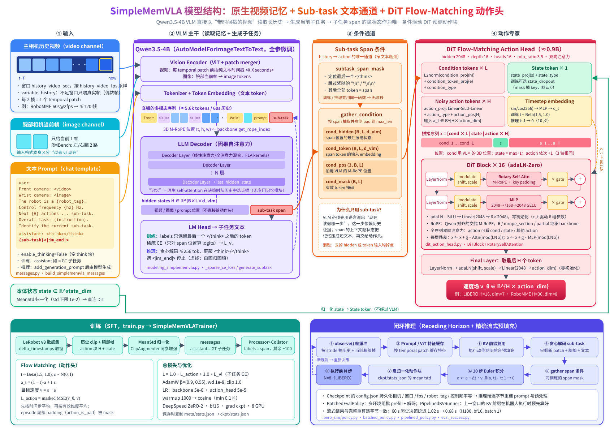

# SimpleMemVLA 模型结构与训推链路说明

> 本文基于仓库当前代码（`e39ab1a`）整理，覆盖模型结构、数据管线、训练流程和闭环推理流程。
> 结构图：[`simplememvla_architecture.svg`](./simplememvla_architecture.svg)



---

## 0. 一句话概括

SimpleMemVLA 没有专门的记忆模块。它把过去一段时间的主相机画面按帧采样，
做成带纯文本时间戳的视频，直接喂给 **Qwen3.5-4B** VLM，由 VLM 原生的 self-attention
在决策时从历史里挑证据。VLM 先用语言输出“当前子任务（sub-task）”，
这段子任务 token 的隐状态和 embedding 是 **DiT flow-matching 动作头**唯一的视觉/语言条件。
动作头再结合本体状态，预测长度为 H 的动作块。

```
历史视频 + 当前腕部帧 + prompt ──► Qwen3.5-4B ──► sub-task 文本（CE 监督）
                                         │
                       sub-task span 的 hidden / embedding / 位置
                                         ▼
                 本体 state ──► DiT Action Head（16 层, 2048） ──► 速度场 v ──► 动作块 (H × action_dim)
```

---

## 1. 代码地图

| 路径 | 作用 |
|---|---|
| `train.py` | 训练入口：解析参数 → 合并 benchmark 默认值 → 构建 dataset / model / collator → `TrainRunner` |
| `configs/sft_params.py` | `ModelArguments` / `DataArguments` / `SFTTrainingArguments` 三组超参 |
| `configs/zero*.json` | DeepSpeed 配置，默认 `zero2.json` |
| `scripts/train.sh` | torchrun 启动脚本，按 benchmark 设置 batch / steps |
| `simplememvla/model/configuration_simplememvla.py` | `SimpleMemVLAConfig`，同时保存推理端重建 pipeline 需要的全部元信息 |
| `simplememvla/model/modeling_simplememvla.py` | `SimpleMemVLAForActionPrediction`：backbone 前向、子任务 CE、条件抽取、flow-matching loss、推理接口 |
| `simplememvla/model/dit_action_head.py` | `DiTActionHead`：DiT block、Qwen 对齐的 M-RoPE、Euler 采样 |
| `simplememvla/data/dataset.py` | `SimpleMemVLADataset`：从 LeRobot v3 数据集取历史 clip / 动作块 / 状态 / 子任务 |
| `simplememvla/data/messages.py` | prompt 模板、视频采样规则 `derive_video_sampling` / `variable_history_frames` |
| `simplememvla/data/collator.py` | `SimpleMemVLADataCollator`、`subtask_span_mask`（训推共用） |
| `simplememvla/data/normalize.py` | MeanStd 归一化（读 `meta/stats.json`） |
| `simplememvla/data/augment.py` | `ClipAugmenter`：同一样本内所有帧共用一组随机裁剪 + 颜色增强参数 |
| `simplememvla/training/sft_trainer.py` | `SimpleMemVLATrainer`：分组学习率、确定性 cosine LR、日志、保存 stats |
| `simplememvla/benchmarks/*.py` | 每个 benchmark 一个 `BenchmarkSpec`（动作维度、相机、历史窗口等） |
| `{libero,robomme,mikasa,rmbench,robomemarena}_sim/` | 各仿真环境的闭环评测：`policy.py`、`batched_policy.py`、`pipelined_policy.py`、`eval_success.py`、`openloop_eval.py` |
| `lerobot/` | vendored LeRobot（数据集读取等） |

---

## 2. Benchmark Spec（每个 benchmark 的差异都在这里）

`simplememvla/benchmarks/<name>.py` 中的 `SPEC` 决定动作/状态维度、相机和历史窗口。
`train.py::resolve_benchmark_defaults` 只在命令行没显式传参时用 spec 补全 `DataArguments`。

| Benchmark | 机器人 | H (chunk) | action_dim | state_dim | 原生 fps | 相机（历史 / 当前） | 历史窗口 |
|---|---|---|---|---|---|---|---|
| LIBERO | Franka Panda 单臂 | 16 | 7 | 9 | 20 | front（视频）/ wrist | 30 s @ 2 fps |
| RoboMME | Panda 单臂 | 30 | 8 | 8 | 20 | front / wrist | 60 s @ 2 fps |
| MIKASA-Robo | Panda 单臂 | 16 | 8 | 8 | 20 | top / wrist | 3 s @ 20 fps |
| RMBench | Aloha-AgileX 双臂 | 30 | 14 | 14 | 250/15 ≈ 16.7 | cam_high / 左右 wrist | 60 s @ 2 fps |
| RoboMemArena | Franka Panda 单臂 | 16 | 7 | 8 | 20 | front / wrist | 126 s @ 1 fps |

各 spec 都打开了 `variable_history=True` 和 `image_aug=True`。另有几个特殊开关：
- RoboMME：`subtask_index_key="subtask_online_index"`，`skip_video_demo_frames=True`。
  回放的示范视频段只作为历史出现，不会被当作训练锚点。
- RoboMemArena：`verbatim_text=True`，任务/子任务文本保持原样，不把 `_` 替换成空格。

---

## 3. 模型结构

### 3.1 顶层：`SimpleMemVLAForActionPrediction`

由两部分组成：

| 模块 | 说明 | 默认学习率 |
|---|---|---|
| `backbone` | `AutoModelForImageTextToText`（默认 `Qwen/Qwen3.5-4B`），包括 ViT 视觉编码器、LLM decoder 和 LM head，默认全参微调（`freeze_backbone=False`） | 5e-6 |
| `action_head` | `DiTActionHead`，约 0.9B 参数 | 5e-5 |

构造时有几处自动继承（`__init__`）：
- `config.hidden_size` 取自 `backbone.config.text_config.hidden_size`，也就是 `d_vlm`。
- DiT 的 `rope_theta`、`mrope_section`、`partial_rotary_factor` 未指定时直接沿用 backbone 文本模型的 `rope_parameters`，让 DiT 的位置编码和 VLM 保持一致。
- `config.backbone_config` 会存下完整的 backbone 配置，推理时不联网也能 `from_config` 重建。

### 3.2 VLM 输入：prompt 结构

`messages.py::build_simplememvla_messages` 生成单轮对话：

```
user:
  Front camera: <video>            ← 历史相机，走 video channel
  Wrist camera: <image>            ← 当前帧相机，走 image channel
  The robot is a {robot_tag}. The control frequency is {hz} Hz.
  The next {H} control actions are predicted from the current sub-task.
  You are given the recent history video ... (each frame is tagged with its timestamp in seconds),
  plus the current image from one more camera.
  The overall task is: {instruction}. Identify the current sub-task.
assistant:
  <think>\n\n</think>\n\n{sub-task}<|im_end|>     ← 训练时提供；推理时由模型生成
```

- 使用 `apply_chat_template(..., enable_thinking=False)`，所以 assistant 段开头总有一个空 think 块。
- 历史视频由 Qwen 的 processor 处理：每 2 帧组成一个 temporal patch，每个 patch 前插入纯文本时间戳 `<X.X seconds>`，和视频预训练格式一致。
- 视频帧由我们预先采好，调用 processor 时传 `do_sample_frames=False`，配合 `VideoMetadata(fps = native_fps / stride)`，确保时间戳正确。

### 3.3 VLM 前向：`_backbone_forward`

1. `_position_ids` 调用 `backbone.model.get_rope_index`，得到 3D M-RoPE 位置 `(3, B, L)`（时间 / 高 / 宽）。
2. 调用 `backbone.model(...)`（不经过 LM head）得到 `last_hidden_state`，形状 `(B, L, d_vlm)`。
3. 有 `labels` 时由 `_sparse_ce_loss` 计算子任务 CE：只取 `labels != -100` 的位置过 `lm_head`，避免对整个约 5k token 的序列算 logits。

> LLM decoder 是混合层结构，训练依赖 flash-attn、flash-linear-attention（FLA）和 causal-conv1d。
> `simplememvla/compat.py::apply_fla_torch_compat` 为 torch 2.4 补齐 FLA 需要的 `torch.distributed.tensor` 接口。

### 3.4 条件通道：sub-task span

这是整个设计的关键：**history → action 只有这一条路**。

- `collator.py::subtask_span_mask(input_ids, think_close_id, whitespace_ids)`：
  找到最后一个 `</think>`，跳过紧跟的 `\n` / `\n\n`，之后的所有 token（子任务文本、`<|im_end|>`、结尾换行）都算 span。
- 训练时 collator 用这个 mask 生成 `labels`（span 外为 -100），所以 **CE 监督的 token 就是送入动作头的 token**。
- 推理时用同一个函数作用于“prompt + 生成结果”，训练和推理的条件因此完全对齐。
- `_gather_condition` 按 span 抽出以下内容，并右侧 pad 到 batch 内最大长度 `L`：

| 输出 | 形状 | 含义 |
|---|---|---|
| `cond_hidden` | `(B, L, d_vlm)` | span 位置的最后层隐状态（看过全部历史的上下文表示） |
| `cond_token` | `(B, L, d_vlm)` | span token 的输入 embedding（`embed(input_ids)`） |
| `cond_pos` | `(3, B, L)` | 这些 token 在 VLM 中的 M-RoPE 位置 |
| `cond_mask` | `(B, L)` | 有效位置 |

README 的消融说明：去掉 hidden 或 token embedding 任一路输入都会掉点。

### 3.5 DiT 动作头：`DiTActionHead`

默认超参：`hidden=2048, depth=16, heads=16, mlp_ratio=3.5, dropout=0`。

**输入 token 化**

| Token | 计算 | 个数 |
|---|---|---|
| condition | `L2normalize(condition_proj(cond_hidden)) + condition_token_proj(cond_token) + condition_type` | L |
| state | `state_proj(state) + state_type`（`use_proprio=True` 时）；训练时可按 `state_dropout_prob` 把它从 key 中 mask 掉（默认 0） | 1 |
| action | `action_proj(a_t)`（Linear‑SiLU‑Linear）`+ action_type + action_pos[:H]`（可学习绝对位置） | H |

拼接为 `x = [cond × L | state | action × H]`，key padding mask 只屏蔽 cond 的 pad 位置（和被 dropout 的 state）。

**位置编码**（`_build_position_ids`）
- cond 直接沿用 VLM 中的 3D 位置；
- state 的位置 = 有效 cond 最大位置 + 1（三个轴相同）；
- action 从下一个位置开始依次 +1。

这样动作 token 在“位置空间”里紧跟子任务文本，和 VLM 的序列保持连续。

**DiT Block（adaLN-Zero）**，共 16 层：
```
shift1, scale1, gate1, shift2, scale2, gate2 = Linear(SiLU(c_t))      # 零初始化
x = x + gate1 · RotarySelfAttn( LN(x)·(1+scale1) + shift1 )
x = x + gate2 · MLP( LN(x)·(1+scale2) + shift2 )                      # MLP: 2048→7168→2048, GELU(tanh)
```
- `RotarySelfAttention`：**双向**全注意力，attention 权重用 fp32 softmax，RoPE 是与 Qwen 对齐的**交错 M-RoPE**（`QwenAlignedMRotaryEmbedding`，支持 partial rotary）。
- 时间条件 `c_t = TimestepEmbedding(t)`：256 维 sin/cos → MLP。
- `DiTFinalLayer`：只取最后 H 个 token → LN + adaLN(shift, scale) → `Linear(2048 → action_dim)`，同样零初始化，所以训练开始时输出速度为 0。

输出：速度场 `v_θ ∈ ℝ^{B × H × action_dim}`。

---

## 4. 数据管线

### 4.1 `SimpleMemVLADataset.__getitem__`

数据格式是 LeRobot v3（`LeRobotDataset`），通过 `delta_timestamps` 一次取出所需窗口：

1. **采样参数**：`derive_video_sampling(sec, fps, native_fps)` 给出
   `n_frames = round(sec × fps)`（向上取偶数，至少 2）和 `stride = round(native_fps / fps)`。
   例如 RoboMME：60 s × 2 fps = 120 帧，stride = 10。
2. **delta_timestamps**：
   - 动作：`[0, 1, …, H−1] / fps`，即从当前帧起的 H 步动作块；
   - 历史相机：`[-(n−1)·stride, …, −stride, 0] / fps`；
   - 当前帧相机和 state 不设 delta，只取当前帧。
3. **动作**：MeanStd 归一化，检查形状为 `(H, action_dim)`；用 `action_is_pad` 生成 `action_mask`，屏蔽 episode 末尾越界的步。
4. **状态**：MeanStd 归一化，形状 `(state_dim,)`。
5. **视觉**：
   - 历史相机 → `(T, H, W, 3)` uint8 clip。若 `variable_history`，用 `<key>_is_pad` 算出真实帧数 `num_real`，再按 `variable_history_frames(num_real)` 从尾部裁剪：取真实帧数，奇数则 +1 补成偶数，至少 2。这样 rollout 刚开始时只喂真实帧，不用大量复制首帧去填满窗口。
   - 当前相机 → 单帧图像。
6. **增强**（`image_aug=True`）：`ClipAugmenter` 每个样本抽一组参数（随机面积 0.9–1 的裁剪后 resize，亮度/对比度/饱和度 ±0.2，色相 ±0.05），**对该样本所有相机的所有帧使用同一组参数**，保证时间上一致。
7. **文本**：`task` 是任务指令；子任务从 `subtask_index` + `meta/subtasks.parquet` 解析（RoboMME 使用 `subtask_online_index`）。拼成 `messages`，assistant 段为 GT 子任务。
8. **锚点过滤**：RoboMME 设置了 `skip_video_demo_frames`，只用 `is_video_demo == False` 的帧作为训练样本。

### 4.2 `SimpleMemVLADataCollator`

逐样本处理：`apply_chat_template` → `processor(text, images, videos, video_metadata, do_sample_frames=False)` → 用 `subtask_span_mask` 生成 `labels`。
然后右 pad 拼 batch：

```
input_ids, attention_mask, mm_token_type_ids, labels      (B, L)
pixel_values_videos, video_grid_thw                       按样本 concat
pixel_values, image_grid_thw                              （有当前帧相机时）
actions (B, H, A), action_mask (B, H, A), state (B, S)
```

序列长度超过 `model_max_length`（默认 8192）会直接报错，不会截断。截断可能切掉子任务 span。

---

## 5. 训练链路

### 5.1 启动

```bash
bash scripts/train.sh robomme
```

```bash
PER_DEVICE_BATCH=4 GRAD_ACCUM=2 RESUME=auto bash scripts/train.sh libero
```

`train.sh` 用 torchrun（默认单机 8 卡）启动 `train.py`，DeepSpeed ZeRO-2，bf16 + tf32，开启 gradient checkpointing，用 wandb 记录。

| Benchmark | per-device batch | grad accum | max steps |
|---|---|---|---|
| rmbench | 8 | 1 | 60000 |
| robomme | 8 | 1 | 60000 |
| mikasa | 4 | 4 | 30000 |
| robomemarena | 8 | 1 | 30000 |
| libero | 48 | 1 | 30000 |

### 5.2 `train.py` 流程

```
HfArgumentParser → (ModelArguments, DataArguments, SFTTrainingArguments)
  └─ resolve_benchmark_defaults：用 BenchmarkSpec 填补未指定字段
  └─ AutoProcessor.from_pretrained(backbone, padding_side="right")
  └─ SimpleMemVLADataset(data_args, spec)
  └─ SimpleMemVLAConfig(... 把相机、窗口、fps、robot_tag、控制频率、子任务列等全部写入 config)
  └─ SimpleMemVLAForActionPrediction.from_backbone(...)      # 加载预训练 VLM + 随机初始化 DiT（转成同 dtype）
  └─ SimpleMemVLADataCollator(processor, max_length)
  └─ TrainRunner → SimpleMemVLATrainer.train() → save_state / save_model
```

### 5.3 前向与损失（`forward`）

```
H        = backbone(input_ids, pixel_values_videos, pixel_values, position_ids)     # (B, L, d_vlm)
L_vl     = CE(lm_head(H[span−1]), input_ids[span])                                   # 子任务监督

t ~ Beta(α=1.5, β=1.0)        ε ~ N(0, I)
a_t      = (1 − t)·a + t·ε                      # t=0 为数据，t=1 为噪声
v_target = ε − a
cond     = gather(H, embed(input_ids), pos, span = labels ≠ −100)
v_θ      = DiT(cond, state, a_t, t)
L_action = masked_mse(v_θ, v_target, action_mask)
L        = 1.0·L_action + 1.0·L_vl
```

- `Beta(1.5, 1)` 的采样会偏向较大的 t（噪声更多的一端）。
- `masked_flow_matching_loss`：先对每个动作维度在有效时间步上求平均，再在有效维度上平均，最后对 batch 求均值。
- 同一次 backbone 前向同时得到 L_vl 和 DiT 条件，两个损失的梯度都会回传到 backbone。动作损失通过 `cond_hidden` 也会更新 VLM。

### 5.4 优化器与调度（`SimpleMemVLATrainer`）

- **4 个参数组**：{backbone, action_head} × {有 / 无 weight decay}。backbone 学习率 5e-6，action_head 学习率 5e-5，weight decay 1e-8。
- AdamW：β=(0.9, 0.95)，eps 1e-8，梯度裁剪 1.0。
- **确定性 LR**：HF scheduler 被替换成不做任何事的 `_FrozenScheduler`。每个 `training_step` 前按 `global_step` 直接算 LR：线性 warmup 1000 步，之后 cosine 衰减到 0.1×。断点续训后 LR 曲线完全可复现。
- `_check_zero_partition_overflow`：ZeRO-1/2 下如果某个参数组每卡分片 ≥ 2³¹ 元素，会直接报错。原因是 DeepSpeed 的 int32 索引会溢出，静默训出 NaN 权重，卡数太少时要注意。
- 非有限 loss 立即抛 `FloatingPointError`。
- 日志额外记录窗口平均的 `action_loss`、`vl_loss`，以及两组 LR。
- `resume`：`false` / `true` / `auto` / 路径。`auto` 在找不到 checkpoint 时会从头开始训练。

### 5.5 Checkpoint 内容

```
<output_dir>/checkpoint-XXXX/
  config.json               # SimpleMemVLAConfig，包含 backbone_config 和全部 pipeline 元信息
  model*.safetensors        # backbone + action_head 权重
  stats.json                # 从 <data_root>/meta/stats.json 复制，用于推理端归一化/反归一化
  + 优化器 / trainer state
```

推理端只依赖 checkpoint 目录，就能重建与训练逐字节一致的 prompt 和视频预处理。

---

## 6. 推理链路

### 6.1 加载（`*_sim/policy.py::get_vla`）

1. `SimpleMemVLAConfig.from_pretrained(ckpt)` → 用 `backbone_config` 执行 `from_config` 构建 backbone，不需要下载原始 Qwen 权重。
2. 读 safetensors（支持分片）；`lm_head` 缺失时调用 `tie_weights()`；任何其他 missing / unexpected key 都报错。
3. 全部转为 bf16，但**检查 rotary `inv_freq` 保持 fp32**，保证 M-RoPE 相位和训练一致。
4. 如果保存时的 transformers 版本和当前环境不一致，会打印警告（5.11.0 ↔ 5.13.1 已验证等价）。
5. 从 `ckpt/stats.json` 构建动作反归一化器和状态归一化器。

### 6.2 单次决策（`LiberoPolicy.predict`，参考实现）

```
observe(frames)                    # 每个控制步把各相机帧写入环形缓冲区
                                   # 历史相机容量 (n_frames−1)·stride+1，当前帧相机容量 1
_history_positions                 # 与训练相同的 stride / variable_history 规则选帧
_process(prompt, add_generation_prompt=True)
  └─ 与训练相同的 messages（subtask=None）→ processor
generate_subtask                   # 贪心解码 ≤ max_reasoning_tokens(256)
  ├─ suppress_tokens = <think>, </think>
  └─ eos = <|im_end|>；超出预算时强制补 <|im_end|> 并告警
拼接 full_ids = prompt + 生成 token (+ "\n")      # 与训练时的 token 序列对齐
span = subtask_span_mask(full_ids)                 # 与训练同一函数
predict_action
  ├─ 对 full_ids 再做一次 backbone 前向 → hidden
  ├─ _gather_condition
  └─ action_head.sample：a ~ N(0, I)·temperature；t 从 1 到 0 均分 num_steps(10) 步
                         a ← a − Δt · v_θ(a, t)          # Euler 积分
反归一化 → 返回 H 步动作 + 子任务文本
```

### 6.3 闭环评测（`eval_success.py::run_group`）

- **Receding horizon**：每次决策只执行动作块的前 `execute_horizon` 步，然后用新观测重新决策。各脚本默认值：LIBERO / MIKASA 为 8，RMBench 为 16，RoboMME 为 16 或 20。
- 多个环境组成一组（`group_size`），由 `BatchedEvalPolicy.generate_batch` 一起推理：
  1. **ViT 特征缓存**：按 `(相机, 帧 i, 帧 i+1)` 缓存每个 temporal patch 的视频特征（`_patch_feat_cache`），只对新出现的 patch 跑 ViT。
  2. **Prompt 缓存**：prompt 的 token 布局只取决于（指令, clip 长度），可以复用。
  3. 左 pad 组 batch，把缓存的视频特征和腕部图像特征填入 embedding，一次 prefill（`use_cache=True`）。
  4. 批量贪心解码，同时**记录每步解码的 hidden state**，直接作为 span 的 `cond_hidden`，不需要像 `predict` 那样再做一次完整前向。
  5. 重新计算 full 序列的 M-RoPE 位置 → `_gather_condition` → `action_head.sample` → 反归一化。
- reset 失败的 episode 记为 `None`，不计入成功率；rollout 中途崩溃的 episode 计为失败。

### 6.4 精确流式推理（`pipelined_policy.py`，`PIPELINED=1`）

相邻两次决策的历史视频几乎完全相同，只是窗口滑过了 `execute_horizon` 帧。`PipelinedKVRunner` 利用这一点：
- 机器人执行当前动作块时（`_prefetch`），提前算出**下一次决策**除最后一个 temporal patch 外的前缀 `[0, S1)` 的 KV cache（`_build_prefix`）；
- 到决策时刻，关键路径上只需处理最新的 patch、腕部图像和其余文本，然后解码和采样动作；
- 要求 prompt 中当前帧相机的 token 位于历史视频之后（否则会报错）；
- 结果和完整重算逐字节一致。README 给出的数据：60 s 历史在 H100 上的决策延迟从 1.02 s 降到 0.68 s。

### 6.5 评测脚本

```bash
CHECKPOINT=./checkpoints/sft/simplememvla/libero_baseline bash scripts/eval_libero.sh
```

```bash
CHECKPOINT=... PIPELINED=1 bash scripts/eval_robomme.sh
```

```bash
CHECKPOINT=... bash scripts/eval_libero_openloop.sh
```

最后一条是开环评测：在数据集 episode 上对比预测动作和 GT。

---

## 7. 训推一致性要点（改代码前必读）

| 不变量 | 保证位置 |
|---|---|
| 子任务 span 的定义训推一致 | 都调用 `collator.subtask_span_mask` |
| 历史帧数和裁剪规则一致 | 都调用 `messages.derive_video_sampling` / `variable_history_frames` |
| prompt 文本逐字节一致 | 都调用 `build_simplememvla_messages`，参数从 checkpoint config 读取；`enable_thinking=False` |
| 解码结束后补 `\n` | 训练序列中 `<|im_end|>` 后有换行，推理时手动补上 |
| 动作/状态归一化一致 | 训练读 `<root>/meta/stats.json`，保存时复制到 ckpt，推理读 `ckpt/stats.json` |
| M-RoPE 相位一致 | DiT 继承 backbone 的 rope 参数；推理时检查 `inv_freq` 为 fp32 |
| 视频时间戳正确 | 预采帧 + `do_sample_frames=False` + `VideoMetadata(fps=native/stride)` |

---

## 8. 扩展到新 benchmark（简要）

1. 把数据转成 LeRobot v3 格式，带上 `observation.images.*`、`observation.state`、`action`、`task`，以及 `subtask_index` + `meta/subtasks.parquet`，并生成 `meta/stats.json`。
2. 在 `simplememvla/benchmarks/` 下新建 spec（H、action_dim、state_dim、相机标签、历史窗口、robot_tag），然后注册到 `_REGISTRY`。
3. 把 `scripts/train.sh` 里的 `case` 加上新 benchmark 的默认 batch 和 steps。
4. 参照现有 `*_sim/policy.py` 写闭环环境适配器。模型侧的所有元信息都可以从 checkpoint config 读取。
